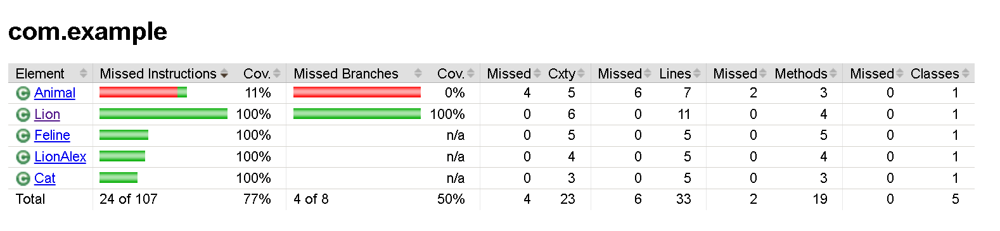

# Java Unit Testing Zoo Project

**Контекст и цели проекта**: проектирование архитектуры Unit-тестов для проверки бизнес-логики классов, изоляция зависимостей и обеспечение полного тестового покрытия (100% Line/Branch Coverage).

**ТЗ (вид работ)**: модульное тестирование (Unit Testing), рефакторинг связей (Dependency Injection), применение Mock-объектов, параметризация тестов и анализ покрытия кода.

**Продукт**: консольный Java-модуль «Учёт животных в зоопарке» (бизнес-логика семейств кошачьих).

**Выполненные задачи**:
1. Рефакторинг и инъекция зависимостей: исключена жёсткая зависимость класса `Lion` от `Feline` посредством внедрения принципа Dependency Injection (DI) через конструктор.
2. Изоляция тестов (Mocking): реализовано конфигурирование заглушек и моков с помощью Mockito для изоляции тестируемых компонентов от внешних классов и интерфейса `Predator`.
3. Параметризация: спроектированы и внедрены параметризованные тест-кейсы (JUnit 4) для валидации граничных условий инициализации пола животного (самец/самка) и обработки исключений.
4. Разработка расширенного функционала: спроектирован класс-наследник `LionAlex` с переопределением логики родительских методов и кастомным конструктором.
5. Тестовое покрытие (Code Coverage): проведена метрика покрытия кодовой базы с помощью плагина JaCoCo. Обеспечено 100% покрытие (Line/Branch Coverage) для целевых классов `Feline`, `Cat`, `Lion` и `LionAlex`.
   
**Область тестирования (Scope)**: модульная изоляция классов, валидация конструкторов, логика наследования, корректность обработки контролируемых исключений (Exceptions).
   
**Окружение**: Java (JDK 11), JUnit 4, Mockito, Maven, JaCoCo Compiler Plugin.

### Метрика тестового покрытия JaCoCo (100% Coverage Verification)

### 📊 Интерактивный отчёт о покрытии (JaCoCo) и CI/CD

* **Отчёт JaCoCo (100% покрытие целевых классов):** [Открыть JaCoCo Report на GitHub Pages](https://leonidgorbunov.github.io/java-unit-testing-zoo/)
* **Автоматический прогон в облаке:** в репозиторий интегрирован пайплайн [GitHub Actions](.github/workflows/tests.yml), выполняющий `mvn clean test jacoco:report` на JDK 11 с публикацией HTML-отчёта в ветку `gh-pages`.
